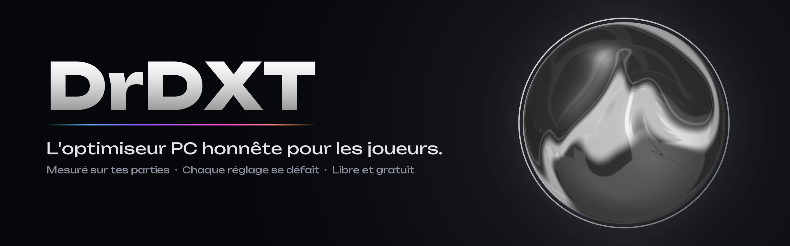
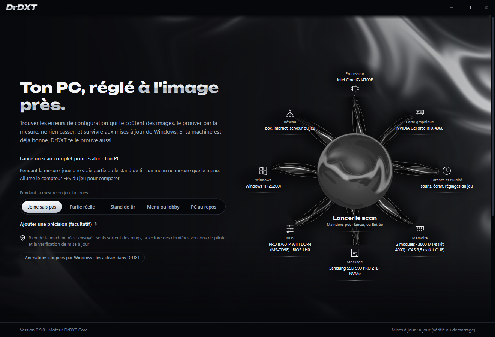
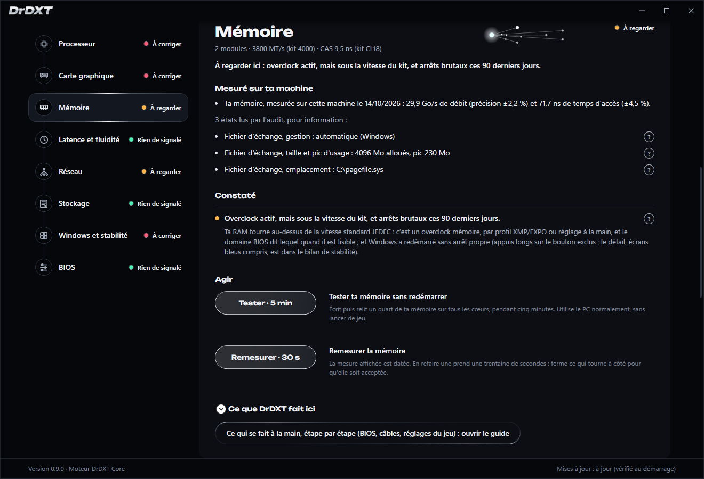
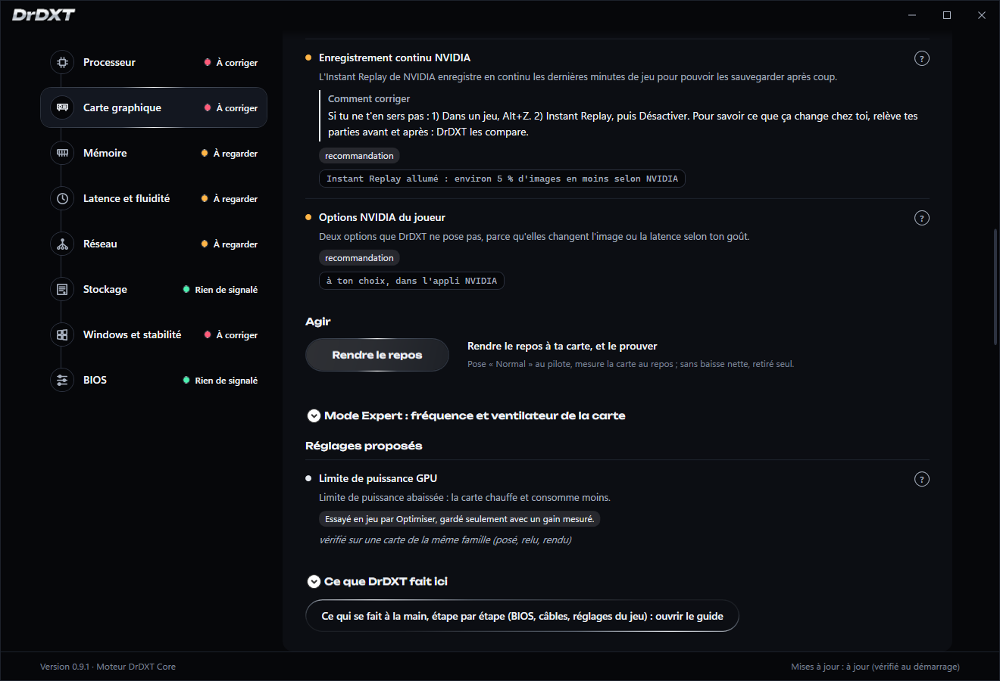

<p align="center">
  
</p>

<p align="center">
  <a href="https://github.com/ablanchard-dev/drdxt/releases"></a>
  <a href="LICENSE"></a>
  
  
  <a href="https://discord.gg/z6HJWDzfB3"></a>
</p>

<p align="center">
  <a href="https://github.com/ablanchard-dev/drdxt/releases"><b>Télécharger</b></a> ·
  <a href="#ce-quil-fait">Ce qu'il fait</a> ·
  <a href="#participer">Participer</a> ·
  <a href="docs/COUVERTURE.md">Ce que DrDXT fait, selon le PC</a> ·
  <a href="https://discord.gg/z6HJWDzfB3">Discord</a> ·
  <a href="README.md">English</a>
</p>

Un optimiseur PC gaming pour Windows. Gratuit, libre, et honnête : il ne promet rien qu'il n'ait mesuré.

DrDXT lit ta machine, te dit ce qui te coûte des images, et pose seulement des réglages qu'il sait défaire. Chaque
réglage est jugé sur tes vraies parties : retiré s'il fait pire, et un gain n'est annoncé que s'il est mesuré. Si ta
machine est déjà bien réglée, il te le dit aussi.

<p align="center">
  
</p>
<p align="center">
  
  
</p>

L'appli parle français et anglais. [CONTRIBUTING.fr.md](CONTRIBUTING.fr.md) et [CONFIDENTIALITE.md](CONFIDENTIALITE.md)
ont leur version anglaise, [SECURITY.md](SECURITY.md) porte les deux langues ; les documents techniques de `docs/` sont
surtout en français.

## Ce qu'il fait

- **Un scan** lit ton processeur, ta carte graphique, ta mémoire, ton stockage, Windows, le réseau et le BIOS. Aucun réglage
  n'est changé à ce stade ; le scan peut seulement installer ou démarrer le service de mesure PresentMon s'il manque.
- **Un docteur par domaine** explique chaque point : ce qui a été lu, ce qui pose problème, ce que DrDXT peut faire, et
  ce qui se fait à la main (BIOS, câbles, réglages du jeu). Quand un point a son correctif, il se lit à part sous
  **Comment corriger**, en étapes numérotées qui nomment ce qui a été lu sur ta machine : l'appli, la valeur, le chemin.
- **Optimiser** pose les réglages utiles, un par un, après un point de restauration. **Essayer en alternance** compare
  un réglage sur tes parties, en blocs avec, sans, sans, avec, et tranche dès qu'il a au moins 3 parties avec et 6 sans (11 parties, dans cet ordre).
- **Tes parties** sont relevées en arrière-plan : images par seconde, 1 % les plus lentes, ce qui limitait, programmes
  ouverts à côté. C'est la seule preuve que DrDXT accepte. Le jeu est trouvé tout seul, en plein écran ou sans bordure,
  et les plus joués même en fenêtré ; les lanceurs, Discord et les applis agrandies sont laissés de côté.
- **L'historique de ta machine** met parties, arrêts ou erreurs, et changements sur une même frise, avec les images par seconde
  de chaque partie sous le nom du jeu.
- **Jeux Unreal Engine 5** : DrDXT lit l'éclairage global et les reflets (Lumen) et, d'après ce qui a freiné tes
  dernières parties de ce jeu, dit s'il vaut la peine de les baisser. C'est un conseil : le réglage se change dans le
  jeu, par toi.
- **Le mode Expert** ouvre la fréquence et le ventilateur de la carte graphique, sur ton accord, avec test de stabilité
  et retour automatique.
- **Corriger les droits** : quand le service d'un autre programme tourne en SYSTEM depuis un fichier que ton compte
  peut remplacer (une élévation de privilèges que n'importe quel programme pourrait utiliser), DrDXT rend ce fichier et
  son dossier aux administrateurs, sur ton clic. Les droits d'origine sont gardés, et **Annuler** les remet, par exemple
  si le programme ne se met plus à jour.
- **Trouver ma sous-tension** (Intel) baisse la tension du processeur palier par palier, avec un test de charge à
  chaque palier et un retour automatique à la valeur d'origine. La valeur stable se reporte ensuite au BIOS, guidée
  pas à pas.
- **Vérifier DrDXT sur mon PC** pose chaque réglage, le relit, le rend et le relit encore, puis écrit un rapport sans
  rien qui te désigne. C'est ainsi que ton matériel entre dans ce que DrDXT sait prouver.

## Les cinq invariants

Cinq règles tiennent le code, et chacune vient d'un échec réel :

- **Prouvé, jamais affirmé.** Un gain n'est dit qu'avec trois parties de chaque côté nettement séparées, et en
  « au moins » : le pire écart entre les deux séries. « Aucun gain mesurable » est une réponse valide, et souvent la
  bonne.
- **Chirurgical.** Aucun service désactivé, aucun nettoyage de Windows, aucun script greffé. Ce qui exige le BIOS reste
  un guide.
- **Réversible.** Tout réglage que DrDXT pose, il sait le défaire : valeur d'origine lue avant toute écriture, retour testé,
  chaque réglage annulable. Les gros changements (Optimiser, l'essai en alternance, « Vérifier DrDXT sur mon PC ») posent
  après un point de restauration. Deux choses ne se défont pas : la réparation de Windows (DISM, sfc), faite par Windows
  lui-même, et une sous-tension AMD, qui ne se défait que par la remise à l'usine de la carte. Ce que la désinstallation
  laisse est listé dans « Ce qui reste ».
- **Honnête sur l'indisponibilité.** Un réglage qui ne s'applique pas dit lequel et pourquoi.
- **Liste noire permanente.** Les mythes de l'optimisation (Nagle, `NetworkThrottlingIndex`, polling 8 000 Hz,
  priorité temps réel, C-states coupés en bloc) sont refusés par un test qui casse si l'un d'eux entre au catalogue.

## Où en est le projet

Version 0.9, utilisable aujourd'hui. Le scan, le docteur, le relevé de tes parties, Optimiser, l'essai en alternance et
le retour arrière de chaque réglage tournent sur de vrais PC. Les réglages de la vérification complète (« Vérifier
DrDXT sur mon PC ») ont été posés, relus et rendus sur la machine de référence (Intel, NVIDIA) ; ceux qui ne touchent
que du matériel AMD restent à vérifier sur une vraie machine ([docs/VALIDATION-AMD.fr.md](docs/VALIDATION-AMD.fr.md)).
Pour AMD, le code est prêt et attend ces rapports : la puissance, la fréquence, le point chaud et le ventilateur de la
carte en partie, les réglages Radeon (Boost, Image Sharpening, RSR, AFMF), la température du processeur, les timings
mémoire et la cause des redémarrages, la limite de puissance, la fréquence et le ventilateur du mode Expert. Chacun reste
en lecture seule ou fermé sur une génération tant qu'un rapport de cette génération ne l'ouvre pas.

Ce qui reste à prouver : un gain mesuré par DrDXT sur des parties, et les cartes AMD, Intel Arc, les portables à deux
cartes et les consoles portables, prévus dans le code mais testés seulement sur des machines reconstituées.
[docs/COUVERTURE.md](docs/COUVERTURE.md) dit, réglage par réglage, ce que DrDXT fait sur chaque type de PC, et pourquoi pas
là où il ne le fait pas.

## Installer

1. Télécharge `DrDXT-Setup-NON-SIGNE.exe` dans la dernière [Release](https://github.com/ablanchard-dev/drdxt/releases).
   Son empreinte SHA-256 est dans la page ; `Get-FileHash` dans PowerShell la recalcule.
2. L'installeur n'est pas encore signé : Windows affiche « Windows a protégé votre ordinateur ». Clique « Informations
   complémentaires », puis « Exécuter quand même ».
3. L'installeur parle français quand Windows est en français, anglais sinon. Deux cases : un raccourci sur le Bureau,
   et « Réappliquer mes réglages au démarrage de Windows et relever la température du processeur pendant mes parties »
   (le service `DrDxtReconciler`, coché par défaut, qui
   réapplique au démarrage de Windows les réglages que tu as gardés, et permet au relevé des parties de lire la
   température du processeur ; décoche-le si tu n'en veux pas).
4. Au premier lancement, « Lancer le scan » lit la machine sans changer aucun réglage (il peut installer ou démarrer le
   service de mesure PresentMon s'il manque). Rien n'est posé avant que tu cliques
   « Optimiser » ou « Essayer en alternance », et chaque réglage se défait depuis « Ce que DrDXT a posé ».
5. Désinstaller : Paramètres, Applications, DrDXT. Le désinstalleur rend d'abord les réglages qu'il connaît, puis retire
   les fichiers. Restent `%LOCALAPPDATA%\DrDXT` (tes relevés) et `%ProgramData%\DrDxt` (ses rapports), à supprimer à la
   main si tu veux repartir de zéro.

Windows 10 ou 11, 64 bits, sur un **compte administrateur** : c'est lui qui donne son accord à chaque réglage. Aucun
.NET à installer, tout est dans l'installeur.

Sur un **compte standard**, DrDXT le dit au lancement. Le scan, le docteur, le relevé des parties et les conseils
marchent ; les réglages de ton propre compte (souris, Game Bar) s'écrivent encore. Tout ce qui demande l'administrateur
(plan d'alimentation, pilote graphique, carte, processeur, services) est refusé tout de suite, avec sa raison : Windows
lancerait le helper de DrDXT sous l'administrateur qui a tapé son mot de passe, et ce helper ne parle pas à ta fenêtre.
Installé depuis un compte standard avec le mot de passe d'un administrateur, le relevé des parties en fond est celui de
cet administrateur, pas le tien.

### Ce qui reste après désinstallation

- **Les réglages gardés sont rendus** : ceux du manifeste signé, et ceux d'un essai en alternance en cours. Un réglage
  qui n'a pas pu l'être est écrit dans le rapport `desinstallation-<date>.txt`, sous `%ProgramData%\DrDxt` ; le manifeste
  reste alors en place, et réinstaller puis désinstaller réessaie.
- **La carte NVIDIA** revient au ventilateur automatique et à un décalage d'horloge de 0 MHz. Une courbe de ventilateur
  ou un décalage posés par un autre outil (MSI Afterburner) repassent aussi à l'automatique et à 0, jusqu'à ce que cet
  outil les remette à son prochain lancement.
- **Les programmes au démarrage** que tu as coupés depuis DrDXT sont réactivés, s'ils sont encore tels que DrDXT les a
  laissés : recoupés ou réactivés à la main depuis, ils restent comme tu les as mis. Ceux de ton compte ne se relisent
  que si la désinstallation tourne avec ton compte ; lancée avec un autre compte administrateur, ils restent coupés et
  le Gestionnaire des tâches les réactive.
- **La fréquence de l'écran** posée par DrDXT reste telle quelle : changer le mode d'affichage pendant une
  désinstallation risque plus que de le laisser. Défais-la depuis DrDXT avant de désinstaller (« Annuler » sur le
  réglage), ou depuis les Paramètres de Windows ensuite.
- **Une sous-tension AMD** posée par DrDXT peut rester, si le pilote la garde au redémarrage : la désinstallation ne sait
  pas la rendre. Un essai en alternance ne la pose jamais. La défaire ne peut que remettre la carte aux réglages d'usine,
  ce qui remet aussi la mémoire, le ventilateur et la puissance réglés dans AMD Software ; DrDXT le dit quand il le fait.
  Voir [docs/SECURITE.md](docs/SECURITE.md), §10.
- **Un test mémoire** programmé depuis DrDXT et pas encore lancé reste programmé : il tourne au prochain redémarrage, puis disparaît.
- **Une sous-tension du processeur** (décalage de tension) posée pour la session en cours n'est pas rendue par la
  désinstallation ; elle part au prochain redémarrage. Défais-la depuis DrDXT avant de désinstaller pour qu'elle parte tout de suite.
- **Un réglage qu'Optimiser essaie encore** (ni gardé ni rendu) au moment de la désinstallation est rendu s'il est un
  réglage de la machine. Un réglage de ta session (souris, Game Bar) reste posé : son origine n'est notée que dans
  `%LOCALAPPDATA%\DrDXT`, que la désinstallation élevée ne lit pas. Laisse Optimiser finir avant ; réinstaller DrDXT le
  rend au lancement suivant.
- **Un réglage de démarrage retiré** (`bootstatuspolicy`, le menu « Windows n'a pas démarré correctement ») reste retiré :
  défais-le depuis DrDXT (« Annuler ») avant de désinstaller, ou avec `bcdedit`. `%LOCALAPPDATA%\DrDXT\bcd-rendu.json` reste aussi.
- **`%ProgramData%\DrDxt`** : les rapports de désinstallation, le manifeste mis de côté, la clé qui le signait, et la
  copie des paquets de pilote que tu as retirés sans les remettre (`pilotes-retires` : jusqu'à quelques Go par paquet
  NVIDIA, et seuls les deux derniers sont gardés).
- **`%LOCALAPPDATA%\DrDXT`** : tes relevés de parties, l'historique de ce que DrDXT a fait, et la dernière mise à jour
  téléchargée.
- **La restauration système** reste activée, avec sa réserve de 5 % et les points DrDXT ; Windows les efface avec le
  temps.

Aucun programme de DrDXT ne tourne plus. Les deux dossiers se suppriment à la main si tu veux repartir de zéro.

Une **mise à jour** arrête le helper pour remplacer ses fichiers : elle ne part pas tant qu'un réglage temporaire est
posé (recherche de sous-tension, ventilateur fixe ou décalage d'horloge en mode Expert). Rends-le d'abord, puis installe.

## Participer

DrDXT s'améliore un PC à la fois, et presque tout ce qui reste à prouver l'est sur du matériel qu'il n'a jamais
vu. L'aide la plus utile ne demande pas de savoir coder :

- **Vérifier DrDXT sur ton PC**, puis glisser le rapport dans un ticket « Rapport de vérification ». Chaque rapport
  montre ce que les réglages font vraiment sur ce matériel, à côté de ce que [docs/COUVERTURE.md](docs/COUVERTURE.md) prévoit.
- **Sans installer DrDXT** : les zips de la [Release](https://github.com/ablanchard-dev/drdxt/releases) lisent ton PC,
  ou font la même vérification, et écrivent le même rapport.
- **Signaler un bug**, ou une phrase de l'appli qui est floue ou fausse dans ta langue.
- **En parler** : questions, bugs et testeurs se retrouvent sur le [Discord](https://discord.gg/z6HJWDzfB3) (en anglais).

Tu écris du code ? [ARCHITECTURE.md](ARCHITECTURE.md) (en anglais) montre comment les pièces s'emboîtent et comment
ajouter un réglage de bout en bout ; [CONTRIBUTING.fr.md](CONTRIBUTING.fr.md) dit comment compiler, tester et proposer
un changement.
Chaque demande de fusion passe la suite de tests en CI, sauf les tests marqués `Machine` (ils lisent le vrai matériel). Une faille de sécurité se signale en privé :
[SECURITY.md](SECURITY.md).

## Ce que DrDXT écrit sur ta machine

Tout réglage passe par la liste du helper, le programme élevé séparé de l'App, qui refuse ce qui n'y est pas ; le
service DrDXT, qui rend tes réglages au démarrage, et la désinstallation appliquent la même liste eux-mêmes, comme
l'App pour les valeurs de ton propre compte. Deux réglages n'y passent pas : la fréquence de l'écran et la priorité des
programmes ouverts à côté du jeu, que l'App change elle-même, sans droits administrateur, comme le feraient les
Paramètres de Windows et le Gestionnaire des tâches. Chaque écriture lit d'abord la valeur d'origine et sait la rendre.
La liste, en entier :

- **Registre, valeurs exactes**, jamais une branche entière : `HwSchMode` (planification GPU accélérée),
  `PagingFiles` (fichier d'échange désactivé remis, ou déplacé vers un SSD), `AllowAutoGameMode` et `AutoGameModeEnabled` (mode Jeu),
  `HistoricalCaptureEnabled` (enregistrement en arrière-plan de la Game Bar), `DirectXUserGlobalSettings` (VRR et
  modèle d'affichage), `MouseSpeed`, `MouseThreshold1` et `MouseThreshold2` (accélération du pointeur),
  `ActiveHoursStart` et `ActiveHoursEnd` (heures d'activité de Windows Update, le réglage de Paramètres, pas la
  stratégie). Deux valeurs ne sont plus proposées, seulement rendues si une ancienne version les a
  écrites : `LowLatencyMode` et `CppcEnable`. Un `LowLatencyMode` gardé avec une ancienne version est encore reposé par le
  service de démarrage, jusqu'à la désinstallation de DrDXT.
- **Programmes au démarrage**, sur ta demande : l'interrupteur de Windows (`StartupApproved`) d'une entrée que tu
  choisis, comme le Gestionnaire des tâches.
- **Pilote NVIDIA**, au profil du jeu, ou au profil global quand le jeu n'en a pas : file de rendu, synchronisation
  verticale, limiteur d'images, mode d'alimentation, et sur ta demande la surcouche DLSS vers le dernier modèle. Le
  profil global aussi, pour rendre « Normal » au mode d'alimentation.
- **Pilote AMD**, par ADLX : Anti-Lag, limite d'images, synchronisation verticale. La limite de puissance et, en mode
  Expert, une vitesse fixe du ventilateur (jamais sous 40 %, retour à la courbe de la carte à 80 °C) s'écrivent, mais
  restent fermées tant qu'aucun rapport de validation n'existe pour cette génération de carte. Sur ton clic
  seulement, la remise à l'usine de la carte, quand une sous-tension gardée par le pilote ne peut pas être rendue
  autrement.
- **Écran** : la fréquence de l'écran principal, réglée sur la plus haute que Windows propose à sa résolution, dans ton
  profil Windows et sans droits administrateur ; gardée seulement si tu confirmes l'image dans les 15 secondes.
- **Plan d'alimentation** : un plan Windows connu, le boost du processeur dans ce plan, et l'économie d'énergie de la
  carte Wi-Fi quand le jeu passe par le Wi-Fi.
- **Processeur** (Intel de bureau) : la limite de puissance PL1 dans son registre, montée à ce que la carte mère permet
  ou plafonnée quand il chauffe trop ; le BIOS remet la sienne au démarrage suivant. Sur ta demande, une recherche de
  sous-tension, palier par palier sous charge, la tension d'origine rendue à la fin ; le résultat, c'est toi qui le
  poses au BIOS. Pour rendre la valeur lue au démarrage (PL1, tension, fréquence maximale AMD), le helper la garde dans
  sa propre clé volatile, `HKLM\SOFTWARE\DrDXT\Helper\CeDemarrage`, que Windows efface au démarrage suivant.
- **Un point de restauration** avant d'appliquer ; la restauration système est activée sur le disque système si elle
  ne l'était pas, avec une réserve de 5 % du disque quand il n'y en avait aucune (laissée à la désinstallation). Un
  point est réutilisé sous 24 heures. DrDXT retire ses propres points plus anciens pour en garder deux, mais jamais
  au-delà du point d'un autre programme : Windows efface les points du plus ancien au plus récent, et retirer un point
  plus récent effacerait aussi celui-là. Avec un point de Windows entre eux, plus de points DrDXT restent.
- **Deux services** : PresentMon, qui mesure les images (installé ou démarré par un scan ou une mesure s'il manque), et
  le service AMD 3D V-Cache.
- **La puce Super I/O de la carte mère** (NCT6687), pour lire ses ventilateurs : ses ports de configuration (0x2E ou
  0x4E) et sa page EC, toutes les 15 secondes au plus, depuis l'App et le service de démarrage, par PawnIO (module
  LpcIO). Des ports pour lire la puce, jamais un réglage : aucun régime, aucune courbe, aucun mode n'est changé.
- **Carte graphique**, dans des bornes : la limite de puissance, essayée en jeu et gardée seulement avec un gain
  mesuré ; en mode Expert, sur ton accord, le décalage d'horloge et une vitesse fixe du ventilateur, rendus seuls si
  DrDXT s'arrête.
- **Droits du service d'un autre programme**, sur ton clic « Corriger les droits » : le propriétaire et l'accès du
  fichier qu'un service SYSTEM lance, et de son dossier, rendus à SYSTEM et aux administrateurs, en lecture pour les
  utilisateurs. Jamais sous Windows, les profils ou DrDXT ; un lien trouvé dans le dossier annule la correction.
  L'origine est gardée et rendue par Annuler ; la désinstallation de DrDXT laisse la correction, et son rapport le dit.
- **Deux règles QoS** pendant une partie, sur ta demande, pour plafonner l'envoi ; retirées à la fin de la partie.
- **Les programmes ouverts à côté du jeu**, sur ta demande, pendant une partie : leur priorité passée de normale à
  inférieure à la normale, jamais le jeu, les processus de Windows qu'il connaît, Defender ou un antivirus courant (par le nom de son
  processus), ou un antitriche. Windows ne la garde pas ;
  DrDXT la rend à la fin de la partie.
- **Démarrage de Windows**, sur ta demande : retirer `bootstatuspolicy` quand un script l'a laissé à IgnoreAllFailures, et
  programmer le test mémoire de Windows au prochain redémarrage (une entrée de démarrage, consommée par ce redémarrage).
- **Pilotes**, sur ta demande : redémarrer un périphérique, retirer un ancien paquet de pilote du magasin de pilotes et
  le remettre.
- **Diagnostic de mémoire Windows** au prochain démarrage, sur ta demande, et son annulation.
- **Les fichiers système de Windows**, seulement sur ton clic « Réparer Windows avec l'outil de Microsoft » : DISM
  `/RestoreHealth` puis `sfc /scannow`, dans une console que tu vois. Windows répare son propre magasin de composants et
  ses fichiers ; DrDXT ne le défait pas.
- **Redémarrer vers le BIOS**, sur ta demande. Le BIOS est lu, jamais écrit.
- **Le service DrDXT** (`DrDxtReconciler`, en SYSTEM, coché par défaut) : il réapplique au démarrage de Windows les
  réglages que tu as gardés, refait cette passe une fois par jour et après une mise à jour de Windows, pose le plafond
  d'envoi pendant les parties du jeu retenu si la protection du ping est allumée (même DrDXT fermé ; retiré à la fin de
  la partie, effacé au redémarrage), et sert la température du processeur à l'App et au relevé, par un tube en lecture
  seule.
- **Le manifeste signé** des réglages gardés, dans `%ProgramData%\DrDxt`, que la désinstallation relit pour les
  rendre.
- **Une tâche planifiée**, « DrDXT releve », créée par l'installeur : elle relève tes parties à l'ouverture de ta
  session, sans droits d'administrateur. Sans le service DrDXT, une partie jouée DrDXT fermé n'a donc pas la
  température du processeur. Retirée à la désinstallation.

Jamais écrit, quoi qu'on demande : Windows Defender, les stratégies et le service de Windows Update, les services de
Windows, le firmware. Le détail,
site par site, est dans [docs/NON-NUISANCE.md](docs/NON-NUISANCE.md) ; la sécurité du helper et ce qui est accepté
comme limite, dans [docs/SECURITE.md](docs/SECURITE.md).

## Ce qui quitte la machine

Pas de télémétrie, pas de compte. Voici tout ce que DrDXT envoie sur le réseau. Ce qu'il lit et garde sur ta machine est
dans [CONFIDENTIALITE.md](CONFIDENTIALITE.md).

- **La dernière version des pilotes graphiques**, à chaque scan, pour te dire si le tien a du retard : la page publique
  d'AMD (`www.amd.com`) et une requête fixe au service public de NVIDIA (`gfwsl.geforce.com`, toujours la même,
  interrogé seulement sur une carte GeForce). Rien ne te désigne.
- **Des pings** vers ta box et vers `1.1.1.1`, pour mesurer la latence ; pendant une partie, aussi vers le serveur du
  jeu : certains ont une durée de vie limitée, comme `tracert`, pour que les routeurs du chemin répondent. Ils suivent la
  route d'une partie à l'autre.
- **Une question à ta box**, à chaque scan, pour le type de NAT : une recherche UPnP sur le réseau de la maison
  (`239.255.255.250`), puis deux demandes à la box elle-même : sa description, puis son adresse WAN, qui n'est jamais affichée. Rien ne sort de la maison,
  aucun port n'est ouvert.
- **La vérification de mise à jour**, au démarrage : deux petits fichiers lus sur `https://ablanchard-dev.github.io/drdxt`,
  et le paquet signé des tables (la liste des régressions connues, des données seulement) sur le même site. GitHub voit
  ton adresse IP, comme pour toute page web. Pour la couper : la variable d'environnement `DRDXT_UPDATE_URL` posée à
  `off`. Une mise à jour ne s'installe jamais sans ton clic ([docs/MISE-A-JOUR.md](docs/MISE-A-JOUR.md)).
- **Le test de ta ligne sous charge**, seulement si tu cliques « Tester ma ligne sous charge » : une vingtaine de
  secondes d'octets nuls reçus de et envoyés à `speed.cloudflare.com` (le serveur de mesure public de Cloudflare), au plus
  400 Mo dans chaque sens, pendant que DrDXT pingue `1.1.1.1` et ta box. Rien qui te désigne.
- **La page support de ta carte mère MSI**, seulement si tu cliques « Ouvrir la page de ta carte » dans le guide du
  BIOS : ton navigateur ouvre `www.msi.com/Motherboard/<modèle>/support`.
- **La page du guide du BIOS**, seulement si tu scannes le QR du guide avec ton téléphone : il ouvre
  `https://ablanchard-dev.github.io/drdxt/guide-bios/`. GitHub voit l'adresse IP du téléphone et l'heure, comme pour
  toute page web. Le guide est écrit après le `#` de l'adresse, qu'un navigateur n'envoie jamais : il reste sur le
  téléphone.
- **Une recherche Windows Update**, seulement si tu cliques « Chercher maintenant » sous le constat Windows Update :
  Windows Update demande aux serveurs de Microsoft ce qui attend, comme Paramètres > Windows Update. Rien ne s'installe.
- **La réparation de Windows**, seulement si tu cliques « Réparer Windows avec l'outil de Microsoft » : DISM télécharge
  des composants sains depuis Windows Update (les serveurs de Microsoft), comme Windows pour ses propres mises à jour.
- **Ton rapport de vérification**, seulement si tu cliques « Envoyer mon rapport » : DrDXT ouvre ton navigateur sur le
  modèle de ticket GitHub, vide, et tu y joins toi-même le rapport. Rien ne part tant que tu ne le soumets pas.
- **L'installeur d'une nouvelle version**, seulement si tu cliques « Installer » : téléchargé à l'adresse écrite dans le
  manifeste signé (la Release GitHub du dépôt), puis son empreinte vérifiée avant qu'il ne se lance.
- **Des pages de `github.com`**, ouvertes dans ton navigateur seulement sur ton clic : le guide pas à pas, le modèle
  de ticket.

Un plantage est écrit dans `%LOCALAPPDATA%\DrDXT\crash.log`, sur ta machine seulement. Un test échoue si une adresse
contactée par le code manque dans cette liste.

## Compiler

Windows 10 ou 11 x64, le SDK **.NET 10**, et Node.js pour les tests de la page du guide du BIOS (ils exécutent son
script). Clone dans un dossier au chemin court, par exemple `C:\src\drdxt` (voir [CONTRIBUTING.md](CONTRIBUTING.md)).

```
dotnet build DrDXT.sln -c Release
dotnet test DrDXT.sln -c Release --no-build --filter "Category!=Machine"
```

**9 887 tests, 0 échec**, mesuré le 25/10/2026 sur 17 projets, hors tests marqués `Machine` (ils lisent le vrai
matériel). Ce chiffre est vérifié par `tools/gates/compte_des_tests.py` contre la dernière exécution. La commande qui
le redonne :

```bash
dotnet test DrDXT.sln -c Release --filter "Category!=Machine" --nologo -v q 2>&1 | grep "Réussi" \
  | sed 's/.*total[^0-9]*\([0-9][0-9]*\).*/\1/' | awk '{s+=$1; n++} END {print n, "projets |", s, "tests"}'
```

L'installeur se construit avec `installer/build-installer.ps1`. Il demande **Inno Setup 6** et les outils C++ de
Visual Studio, pour compiler en natif le lanceur qui reçoit l'élévation.

## Carte du code

| Projet | Rôle |
|---|---|
| `DrDxt.Core` | contrats, résultats, codes d'erreur, opérations privilégiées |
| `DrDxt.Detection` | matériel, état des réglages, réseau |
| `DrDxt.Measurement` | PresentMon, repli DXGI, réseau, test mémoire |
| `DrDxt.Profiles` | profils par puce et leurs recommandations |
| `DrDxt.Application` | catalogue des réglages, moteur d'application, retour arrière, bornes GPU |
| `DrDxt.ElevatedHelper` | le programme élevé qui écrit, derrière sa liste blanche |
| `DrDxt.Lanceur` | l'exécutable natif qui reçoit l'élévation et relance les autres avec un environnement propre |
| `DrDxt.Reconciler*` | manifeste signé, réapplication au démarrage |
| `DrDxt.Bios` | lecture du BIOS et guide, jamais d'écriture |
| `DrDxt.GpuNative` | NVAPI, ADLX, NVML |
| `DrDxt.Infrastructure` | les textes de l'App (français et anglais), la mise à jour signée, le journal de diagnostic, l'historique des réparations |
| `DrDxt.App` | l'interface (WPF) |
| `tools/` | bancs et sondes hors solution, dont le zip de validation (`amd-harness`) |
| `server/` | un serveur gardé dans la solution avec ses tests, non déployé : la mise à jour passe par GitHub Pages |

Par où commencer : [ARCHITECTURE.md](ARCHITECTURE.md), puis [docs/NON-NUISANCE.md](docs/NON-NUISANCE.md), [docs/SECURITE.md](docs/SECURITE.md), puis
[docs/INSTRUMENTS.md](docs/INSTRUMENTS.md) et [docs/OU-VIT-LE-GAIN.md](docs/OU-VIT-LE-GAIN.md) pour ce que chaque
mesure peut prouver. Les conventions de travail sont dans [CONTRIBUTING.fr.md](CONTRIBUTING.fr.md).

## Licence

DrDXT est un logiciel libre sous **GPL-3.0**. Le texte complet est dans `LICENSE` et livré avec chaque copie. Tu peux
l'utiliser, le copier, le modifier et le redistribuer, même contre de l'argent, à condition de publier le code source
de ta version sous la même licence. Une version fermée, ou payante sans source, n'est pas permise. Le nom « DrDXT »
désigne ce projet : une version modifiée se présente sous son propre nom.

Livrés à côté : PresentMon (Intel, licence MIT, `PresentMon-NOTICE-MIT.txt`) et QRCoder (licence MIT,
`QRCoder-LICENSE-MIT.txt`). NVAPI (NVIDIA) et ADLX (AMD) ne sont pas livrés : DrDXT appelle les bibliothèques que ton
pilote a installées, d'après leurs en-têtes publics.
