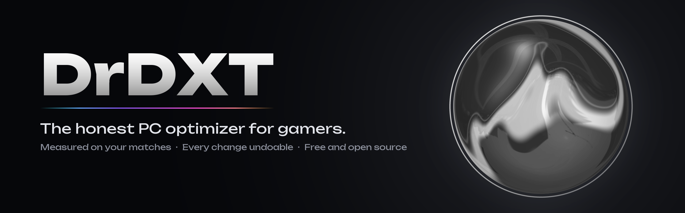
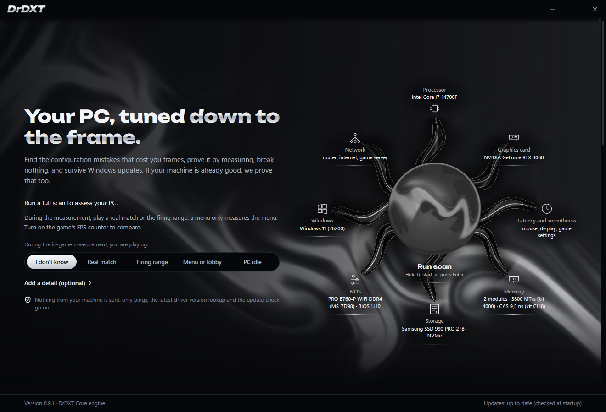
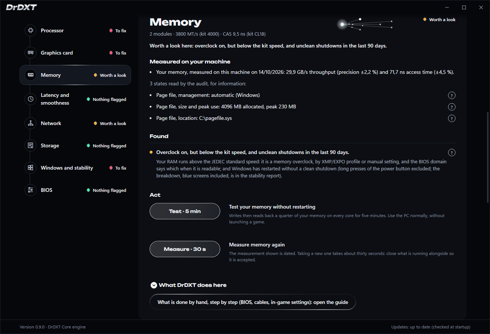
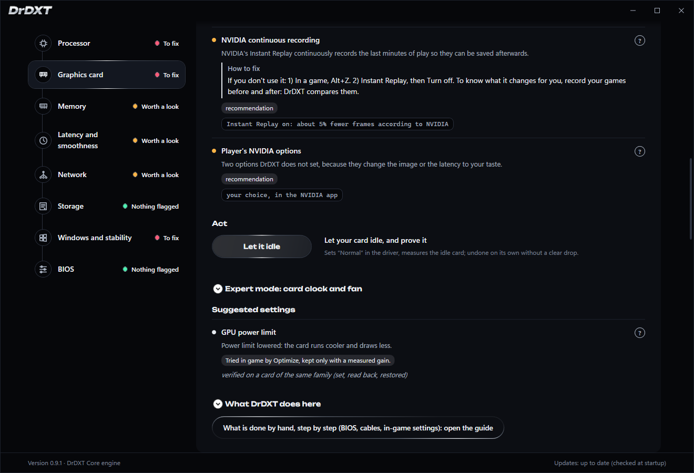

<p align="center">
  
</p>

<p align="center">
  <a href="https://github.com/ablanchard-dev/drdxt/releases"></a>
  <a href="LICENSE"></a>
  
  
  <a href="https://discord.gg/z6HJWDzfB3"></a>
</p>

<p align="center">
  <a href="https://github.com/ablanchard-dev/drdxt/releases"><b>Download</b></a> ·
  <a href="#what-it-does">What it does</a> ·
  <a href="#contributing">Contributing</a> ·
  <a href="docs/COUVERTURE.md">What DrDXT does, by PC</a> ·
  <a href="https://discord.gg/z6HJWDzfB3">Discord</a> ·
  <a href="README.fr.md">Français</a>
</p>

A PC gaming optimizer for Windows. Free, open source, and honest: it promises nothing it has not measured.

DrDXT reads your machine, tells you what is costing you frames, and only applies settings it knows how to undo. Every
setting is judged on your real matches: kept if it brings something, reverted otherwise. If your machine is already
well set up, it tells you that too.

<p align="center">
  
</p>
<p align="center">
  
  
</p>

The app speaks English and French. [CONTRIBUTING.md](CONTRIBUTING.md), [PRIVACY.md](PRIVACY.md) and
[SECURITY.md](SECURITY.md) are in English; the technical documents under `docs/` are in French.

## What it does

- **A scan** reads your processor, graphics card, memory, storage, Windows, network and BIOS. Nothing is written at
  this point.
- **A doctor per domain** explains each point: what was read, what is wrong, what DrDXT can do, and what has to be done
  by hand (BIOS, cables, in-game settings). When a point has a fix, it reads apart under **How to fix**, in numbered
  steps that name what was read on your machine: the app, the value, the path.
- **Optimize** applies the useful settings one by one, after a restore point. **Try it every other game** compares one setting
  across your games in blocks of with, without, without, with, and decides at 3 games with against 6 without.
- **Your matches** are recorded in the background: frames per second, the slowest 1 %, what was the bottleneck, which
  programs were open alongside. This is the only proof DrDXT accepts. The game is found on its own, full screen or
  borderless, and the most played ones even windowed; launchers, Discord and maximized desktop apps are left aside.
- **Your machine's history** puts matches, shutdowns or errors, and changes on one timeline, with each match's frames per second
  under the game's name.
- **Unreal Engine 5 games**: DrDXT reads the global illumination and reflections settings (Lumen) and, from what
  slowed your last matches of that game, says whether lowering them is worth trying. It is advice: the setting is
  changed in the game, by you.
- **Expert mode** opens the graphics card's clock offset and fan speed, with your consent, with a stability test and
  automatic rollback.
- **Find my undervolt** (Intel) lowers the processor voltage step by step, with a load test at each step and an
  automatic return to the original value. The stable value is then yours to write in the BIOS, guided step by step.
- **Check DrDXT on my PC** applies each setting, reads it back, reverts it and reads it again, then writes a report
  with nothing that identifies you. This is how your hardware enters what DrDXT can prove.

## The five invariants

Five rules hold the code, and each comes from a real failure:

- **Proven, never claimed.** A gain is shown only above the noise of the measurement. "No measurable gain" is a valid
  answer, and often the right one.
- **Surgical.** No service disabled, no Windows debloat, no bolted-on script. What requires the BIOS stays a guide.
- **Reversible.** Original value read before any write, rollback tested, restore point.
- **Honest about unavailability.** A setting that does not apply says which one and why.
- **Permanent blacklist.** The optimization myths (Nagle, `NetworkThrottlingIndex`, 8,000 Hz polling, realtime
  priority, C-states disabled wholesale) are refused by a test that breaks if one of them enters the catalog.

## Where the project stands

Version 0.9, usable today. The scan, the doctor, match recording, Optimize, the every-other-game trial and the rollback
of every setting run on real PCs. The settings of the full check ("Check DrDXT on my PC") were applied, read back and
restored on the reference machine (Intel, NVIDIA); those that only touch AMD hardware are still to be checked on a
real machine ([docs/VALIDATION-AMD.md](docs/VALIDATION-AMD.md)).

Still to prove: a gain measured by DrDXT over matches, and AMD cards, Intel Arc, dual-GPU laptops and handhelds,
covered in the code but tested only on reconstructed machines. [docs/COUVERTURE.md](docs/COUVERTURE.md) says, setting
by setting, what DrDXT does on each kind of PC, and why not where it does not.

## Install

1. Download `DrDXT-Setup-NON-SIGNE.exe` from the latest [Release](https://github.com/ablanchard-dev/drdxt/releases).
   Its SHA-256 is on the page; `Get-FileHash` in PowerShell recomputes it.
2. The installer is not signed yet: Windows shows "Windows protected your PC". Click "More info", then "Run anyway".
3. Two checkboxes: a Desktop shortcut, and the `DrDxtReconciler` service, unchecked by default, which reapplies at
   Windows startup the settings you kept.
4. On first launch, "Run scan" reads the machine without writing anything. Nothing is applied before you click
   "Optimize" or "Try it every other game", and every setting can be undone from "What DrDXT set".
5. Uninstall: Settings, Apps, DrDXT. The uninstaller first reverts the settings it knows about, then removes the files.
   `%LOCALAPPDATA%\DrDXT` (your records) and `%ProgramData%\DrDxt` (its reports) remain; delete them by hand to start
   from scratch.

Windows 10 or 11, 64-bit, on an **administrator account**: it is the one that consents to each setting. On a standard
account, Windows would ask for an administrator's password and the settings would go into that account's profile:
this is not supported. No .NET to install, everything is in the installer.

### What remains after uninstalling

- **Kept settings are reverted**: those in the signed manifest, and those of an alternating trial in progress. A
  setting that could not be reverted is written in the `desinstallation-<date>.txt` report under `%ProgramData%\DrDxt`;
  the manifest then stays in place, and reinstalling then uninstalling tries again.
- **The NVIDIA card** goes back to automatic fan control and a 0 MHz clock offset. A fan curve or an offset set by
  another tool (MSI Afterburner) also goes back to automatic and 0, until that tool sets them again the next time it
  starts.
- **An AMD undervolt** set by DrDXT may remain, if the driver keeps it across a restart: uninstalling cannot restore it.
  An alternating trial never sets one. See [docs/SECURITE.md](docs/SECURITE.md), §10.
- **`%ProgramData%\DrDxt`**: the uninstall reports, the set-aside manifest, the key that signed it, and the copy of the
  driver packages you removed.
- **`%LOCALAPPDATA%\DrDXT`**: your game records and the history of what DrDXT did.
- **System Restore** stays on, with its 5 % reserve and the DrDXT points; Windows deletes them over time.

No DrDXT program runs anymore. Both folders can be deleted by hand if you want a clean slate.

An **update** stops the helper to replace its files: a fixed fan speed or a clock offset set in Expert mode then stays
set until the next restart, which clears it.

## Contributing

DrDXT gets better one PC at a time, and most of what it still has to prove is on hardware it has never seen.
The most useful help does not require writing code:

- **Check DrDXT on your PC**, then drop the report into a "Verification report" issue. Each report shows
  what the settings really do on that hardware, next to what [docs/COUVERTURE.md](docs/COUVERTURE.md) plans.
- **Without installing DrDXT**: the zips in the [Release](https://github.com/ablanchard-dev/drdxt/releases) read your
  PC, or run the same verification, and write the same report.
- **Report a bug**, or a sentence in the app that is unclear or wrong in your language.
- **Talk**: questions, bug reports and testers meet on [Discord](https://discord.gg/z6HJWDzfB3).

Writing code? [ARCHITECTURE.md](ARCHITECTURE.md) shows how the pieces fit and how to add a setting from end to end;
[CONTRIBUTING.md](CONTRIBUTING.md) explains how to build, test and propose a change. Every pull
request runs the full test suite in CI. A security issue is reported in private: [SECURITY.md](SECURITY.md).

## What DrDXT writes on your machine

Every setting goes through the list of the helper, the elevated program separate from the app, which refuses
anything not on it; the DrDXT service, which restores your settings at startup, and the uninstaller apply the same list
themselves. Every write first reads the original value and knows how to restore it. The full list:

- **Registry, exact values**, never a whole branch: `HwSchMode` (hardware-accelerated GPU scheduling), `PagingFiles`
  (disabled page file restored, or moved to an SSD), `AllowAutoGameMode` and `AutoGameModeEnabled` (Game Mode), `HistoricalCaptureEnabled`
  (Game Bar background recording), `DirectXUserGlobalSettings` (VRR and presentation model), `MouseSpeed`,
  `MouseThreshold1` and `MouseThreshold2` (pointer acceleration), `ActiveHoursStart` and `ActiveHoursEnd` (Windows
  Update active hours, the Settings option, not the policy). Two values are no longer applied, only reverted if an
  older version wrote them: `LowLatencyMode` and `CppcEnable`.
- **Startup apps**, on request: the Windows on/off switch (`StartupApproved`) of an entry you choose, as Task Manager
  does.
- **NVIDIA driver**, on the game's profile, or on the global profile when the game has none: render queue, vertical
  sync, frame limiter, power mode, and on request the DLSS override to the latest model. The global profile also, to set
  the power mode back to "Normal".
- **AMD driver**, through ADLX: power limit, Anti-Lag, frame rate target, vertical sync. On your click only, the card's
  factory reset, when an undervolt kept by the driver cannot be given back any other way.
- **Display**: the main screen's refresh rate, set to the highest Windows offers at its resolution, in your Windows
  profile and without admin rights; kept only if you confirm the picture within 15 seconds.
- **Power plan**: a known Windows plan, processor boost within that plan, and the Wi-Fi adapter's power saving when the
  game runs over Wi-Fi.
- **Processor** (desktop Intel): the PL1 power limit in its register, raised to what the board allows or capped when the
  processor runs too hot; the BIOS puts its own back at the next boot. On request, an undervolt search, step by step
  under load, with the original voltage restored at the end; the result is yours to set in the BIOS. To give back the
  value read at boot (PL1, voltage, AMD maximum frequency), the helper keeps it in its own volatile key,
  `HKLM\SOFTWARE\DrDXT\Helper\CeDemarrage`, which Windows erases at the next boot.
- **One restore point** before applying; System Restore is turned on for the system drive if it was off, with a
  reserve of 5 % of the drive when there was none (kept after uninstalling). At most two DrDXT points, reused within
  24 hours.
- **Two services**: PresentMon, which measures frames, and the AMD 3D V-Cache service.
- **The motherboard's Super I/O chip** (NCT6687), to read its fans: its configuration ports (0x2E or 0x4E) and its
  EC page, every 5 seconds at most, from the app and the startup service, through PawnIO (LpcIO module). Ports used
  to read the chip, never a setting: no fan speed, curve or mode is changed.
- **Graphics card**, within bounds: the power limit, tried in-game and kept only with a measured gain; in Expert mode,
  with your consent, the clock offset and a fixed fan speed, reverted on their own if DrDXT stops.
- **Two QoS rules** during a match, on request, to cap upload; removed when the match ends.
- **Programs open next to the game**, on request, during a match: their priority lowered from normal to below normal,
  never the game, Windows, security software or an anti-cheat. Windows does not keep it; DrDXT gives it back at the end
  of the match.
- **Windows boot settings**, five exact elements, on request, to remove a setting left by a script.
- **Drivers**, on request: restart a device, remove an old driver package from the driver store and put it back.
- **Windows Memory Diagnostic** at the next boot, on request, and its cancellation.
- **Reboot to BIOS**, on request. The BIOS is read, never written.
- **The signed manifest** of kept settings, in `%ProgramData%\DrDxt`, which the uninstaller reads to revert them.
- **A scheduled task**, "DrDXT releve", created by the installer: it records your matches when your session opens, without
  administrator rights. Without the DrDXT service, a match played with DrDXT closed has no processor temperature.
  Removed when uninstalling.

Never written, whatever is asked: Windows Defender, the Windows Update policies and service, Windows services,
firmware. The details, site by
site, are in [docs/NON-NUISANCE.md](docs/NON-NUISANCE.md); the helper's security and the accepted limits are in
[docs/SECURITE.md](docs/SECURITE.md).

## What leaves the machine

No telemetry, no account. Here is everything DrDXT sends over the network. What it reads and keeps on your machine is
in [PRIVACY.md](PRIVACY.md).

- **The latest graphics driver version**, at each scan, to tell you whether yours is behind: AMD's public page
  (`www.amd.com`) and one fixed request to NVIDIA's public service (`gfwsl.geforce.com`, always the same, queried only
  on a GeForce card). Nothing identifies you.
- **Pings** to your router and to `1.1.1.1`, to measure latency; during a match, also to the game server, to follow the
  route from one match to the next.
- **One question to your router**, at each scan, for the NAT type: a UPnP search on the home network
  (`239.255.255.250`), then a single request for its WAN address, which is never shown. Nothing leaves the home, no port
  is opened.
- **The update check**, at startup: two small files read from `https://ablanchard-dev.github.io/drdxt`, and the signed
  tables package (the list of known regressions, data only) from the same site. GitHub sees your IP address, as with any
  web page. To turn it off: the `DRDXT_UPDATE_URL` environment variable set to `off`. An update never installs without
  your click ([docs/MISE-A-JOUR.md](docs/MISE-A-JOUR.md)).
- **The line test under load**, only if you click "Test my line under load": about twenty seconds of empty bytes
  received from and sent to `speed.cloudflare.com` (Cloudflare's public speed test server), at most 400 MB each way,
  while DrDXT pings `1.1.1.1` and your router. Nothing about you is in it.
- **Your MSI motherboard's support page**, only if you click "Open your board's page" in the BIOS guide: your browser
  opens `www.msi.com/Motherboard/<model>/support`.
- **A Windows Update search**, only if you click "Check now" under the Windows Update finding: Windows Update asks
  Microsoft's servers what is waiting, as Settings > Windows Update does. Nothing is installed.
- **Your verification report**, only if you click "Send my report": DrDXT opens your browser on the empty GitHub
  issue template, and you attach the report yourself. Nothing leaves until you submit it.
- **The installer of a new version**, only if you click "Install": downloaded from the address written in the signed
  manifest (the GitHub Release of the repository), then its fingerprint checked before it runs.
- **Pages on `github.com`**, opened in your browser only on your click: the step-by-step guide, the issue template.

A crash is written to `%LOCALAPPDATA%\DrDXT\crash.log`, on your machine only. A test fails if an address contacted by
the code is missing from this list.

## Build

Windows 10 or 11 x64 and the **.NET 10** SDK. Nothing else for the application and the tests.

```
dotnet build DrDXT.sln -c Release
dotnet test DrDXT.sln -c Release --no-build --filter "Category!=Machine"
```

**8,637 tests, 0 failures**, measured on 23/10/2026 across 17 projects, excluding tests marked `Machine` (they read the
real hardware). The number is checked by `tools/gates/compte_des_tests.py` against the last run. The command that gives
it back (an English .NET SDK; with a French one, see the French README):

```bash
dotnet test DrDXT.sln -c Release --filter "Category!=Machine" --nologo -v q 2>&1 | grep "Passed!" \
  | sed 's/.*Total[^0-9]*\([0-9][0-9]*\).*/\1/' | awk '{s+=$1; n++} END {print n, "projects |", s, "tests"}'
```

The installer is built with `installer/build-installer.ps1`. It also needs **Inno Setup 6** and the Visual Studio C++
tools, to compile natively the launcher that receives elevation.

## Code map

| Project | Role |
|---|---|
| `DrDxt.Core` | contracts, results, error codes, privileged operations |
| `DrDxt.Detection` | hardware, settings state, network |
| `DrDxt.Measurement` | PresentMon, DXGI fallback, network, memory test |
| `DrDxt.Profiles` | per-chip profiles and their recommendations |
| `DrDxt.Application` | settings catalog, apply engine, rollback, GPU bounds |
| `DrDxt.ElevatedHelper` | the elevated program that writes, behind its allowlist |
| `DrDxt.Lanceur` | the native executable that receives elevation and relaunches the others with a clean environment |
| `DrDxt.Reconciler*` | signed manifest, reapplication at startup |
| `DrDxt.Bios` | BIOS reading and guide, never a write |
| `DrDxt.GpuNative` | NVAPI, ADLX, NVML |
| `DrDxt.Infrastructure` | the app's texts (French and English), signed updates, diagnostics log, repair history |
| `DrDxt.App` | the user interface (WPF) |
| `tools/` | benches and probes outside the solution, including the validation zip (`amd-harness`) |

Where to start: [ARCHITECTURE.md](ARCHITECTURE.md), then [docs/NON-NUISANCE.md](docs/NON-NUISANCE.md), [docs/SECURITE.md](docs/SECURITE.md), then
[docs/INSTRUMENTS.md](docs/INSTRUMENTS.md) and [docs/OU-VIT-LE-GAIN.md](docs/OU-VIT-LE-GAIN.md) for what each
measurement can prove. Working conventions are in [CONTRIBUTING.md](CONTRIBUTING.md).

## License

DrDXT is free software under **GPL-3.0**. The full text is in `LICENSE` and ships with every copy. You may use, copy,
modify and redistribute it, even for money, provided you publish the source code of your version under the same
license. A closed version, or a paid one without source, is not allowed. The name "DrDXT" refers to this project: a
modified version goes by its own name.

Shipped alongside: PresentMon (Intel, MIT license, `PresentMon-NOTICE-MIT.txt`) and QRCoder (MIT license,
`QRCoder-LICENSE-MIT.txt`). NVAPI (NVIDIA) and ADLX (AMD) are not shipped: DrDXT calls the libraries your driver
installed, from their public headers.
